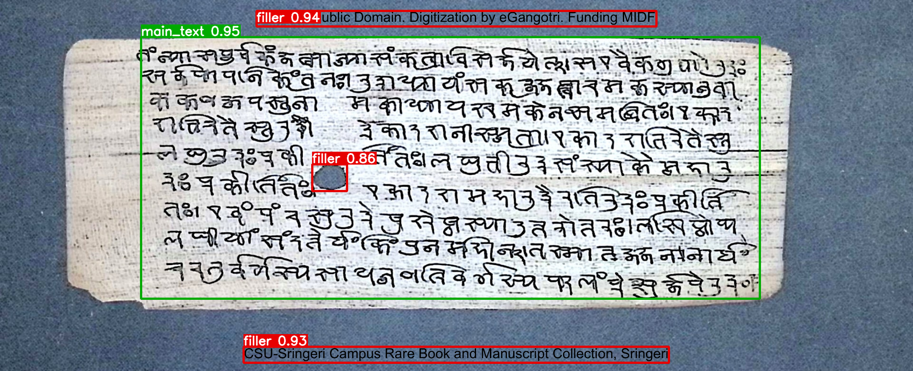
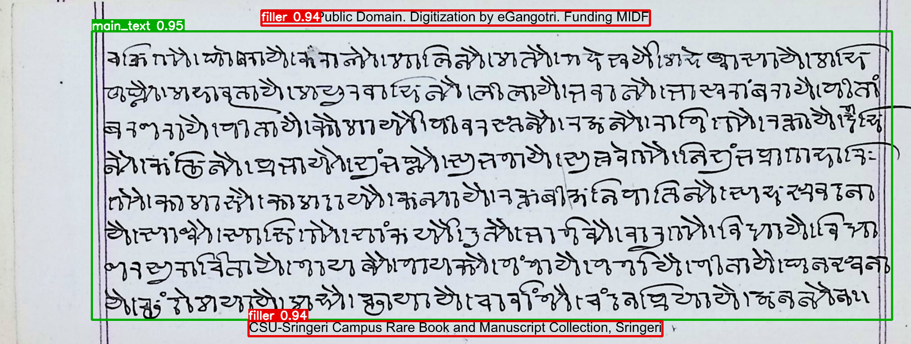
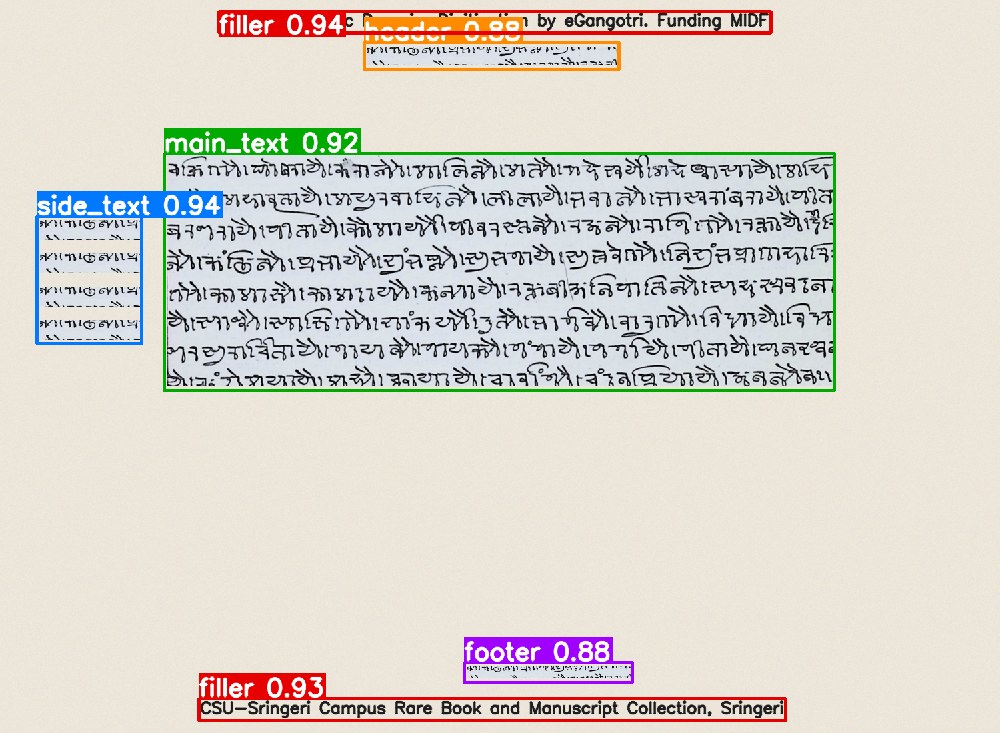

# Manuscript Layout Region Detection

End-to-end Python pipeline that finds and classifies layout regions on historical manuscript pages
(palm-leaf and paper): **header, footer, main_text, side_text, filler**.
It writes annotated images plus JSON predictions (bounding box, label, confidence) for single images or whole folders.

```
python inference.py --input ./data/samples --output ./results
```





### All five classes in one picture
The two assignment samples contain only body text plus banners/hole, so they correctly yield only `main_text` and `filler`.
`data/demo/demo_all_five_classes.png` (real handwriting crops placed as header, footer and margin notes, plus English banners)
shows every label firing: output in `results_example_demo/`.



### Additional test images (outside the assignment samples)
Besides the two assignment samples, the pipeline was also run on **3-4 further manuscript images** of different scripts and
layouts. The two results below are shown because they are the **clearest and most representative**; the others gave
similar behaviour and are not reproduced here to keep this README short. They are *visual spot checks*, not a benchmark -
no ground-truth labels exist, so no accuracy figure is claimed.

| Latin-script handwritten paper page | Double-page spread with red rubrication |
|---|---|
|(
) | (
) |
| A different script and a darker, aged paper substrate. The body is found as `main_text`; a short block in the top-left margin is reported as `side_text` and a small mark above the first line as `filler`. | Two facing pages with red and black ink. The writing area is found as `main_text` (0.95). The two pages are returned as **one** box, and the folio number (bottom-left) and the decorative ornament (right edge) are not labelled - see Known limitations. |

What these show: the detector is script-independent (geometry-based, never reads the characters), copes with aged,
non-white substrates and coloured ink, and always keeps boxes inside the image. They also expose the limits listed in section 5,
so they are included deliberately rather than only showing best cases.

---------------------------------------------------------------------------------------------------

## 1. Setup

Python >= 3.9. One system package (Tesseract) is used only to recognise the *English* overlay text that counts as `filler`.

```bash
# Linux / Colab
sudo apt-get install -y tesseract-ocr          # (Colab: !apt-get -qq install tesseract-ocr)
# macOS:  brew install tesseract

python -m venv .venv && source .venv/bin/activate
pip install -r requirements.txt
```

No Tesseract? Everything still runs - English banners just won't be detected (a warning is logged; use `--no-ocr` to silence it).

## 2. Usage

```bash
python inference.py --input ./data/samples --output ./results        # folder (recursive)
python inference.py --input page.jpg --output ./results              # single file
python inference.py --input ./scans --output ./results --no-ocr --no-deskew --work-size 2000
```

| flag | meaning |
|---|---|
| `--input` | image file or folder (jpg, png, tif, bmp, webp) |
| `--output` | output folder (created) - may even live inside `--input`; its contents are never re-processed |
| `--no-recursive` | do not descend into sub-folders |
| `--no-ocr` | skip English-text detection |
| `--no-deskew` | disable skew estimation |
| `--work-size N` | analysis resolution, long side in px (default 1600) |

Exit codes: `0` all ok, `1` some files failed (the rest are still processed, errors listed in `predictions.json`), `2` bad input.

### Output layout
```
results/
  annotated/<name>_annotated.png   # copy of the page with coloured boxes + "label confidence"
  json/<name>.json                 # one file per page
  predictions.json                 # all pages + any errors
```
Sub-folder images are named `sub__page.json` so names never collide. **Inputs are opened read-only and never modified.**

```json
{
  "image": "sample_palm_leaf.png", "width": 2048, "height": 834,
  "page_bbox": [142, 78, 1779, 699], "skew_deg": 1.5,
  "predictions": [
    {"label": "main_text", "bbox": [316, 83, 1704, 671], "confidence": 0.95, "source": "block_geometry"},
    {"label": "filler",    "bbox": [700, 369, 778, 429], "confidence": 0.8582, "source": "binding_hole"},
    {"label": "filler",    "bbox": [575, 24, 1472, 59],  "confidence": 0.9375, "source": "ocr_overlay"}
  ]
}
```
`bbox = [x0, y0, x1, y1]` in pixels of the **original** image, always clipped inside the image.
`skew_deg` is the rotation applied *for analysis only* (boxes are mapped back). `source` says which detector fired.

## 3. Method and model rationale

**Why no deep model?** The assignment ships no labelled data (only two sample images), so a trained detector
(YOLO / DETR / LayoutLM-style) would have nothing honest to learn from and would be impossible to validate.
A deterministic, explainable pipeline is reproducible, runs on CPU in ~2 s/page, works for any script
(it never reads the characters), and can later *bootstrap* a learned model (see section 6).

```
image -> work copy (<=1600px)
  1. page localisation      border-colour model in Lab; "page == frame" fallbacks (flat scans, lighting gradients)
  2. ink extraction         dilate+median background estimate -> subtract (flattens lighting/stains/bleed-through)
                            -> Otsu with floor -> remove specks, ruling lines, big solid blobs
  3. filler detectors       a) OCR (Tesseract, eng) on top/bottom 15% strips, 2 image views, line grouping
                            b) binding holes: solid round blobs that survive a disk-opening (even if touching writing)
                            (OCR strips are upscaled for small images)
  4. deskew (analysis)      projection-profile angle search +-5 deg; boxes mapped back afterwards
  5. block segmentation     dilation scaled by median glyph height (script/scale independent) -> lines
  6. paragraph merge        stack lines using the page's own median line gap
  7. classification         geometry relative to the largest-ink block ("body core"); then first/last line -> header/footer
  8. post-process           map to original pixels, clip to image, sort, write JSON + annotated PNG
```

### How each class is decided
| class | rule |
|---|---|
| `main_text` | the largest-ink block, plus other heavy blocks (>=35% of its ink) beside it = extra columns |
| `header` | (a) block fully **above** the core with a clear gap, in the top 22% of the page; or (b) **first text line** of the body when no gap exists (palm-leaf folios, see below) |
| `footer` | (a) same, below the core, bottom 22%; or (b) **last text line** of the body |
| `side_text` | light block **beside** the core (vertical overlap, little horizontal overlap) in the outer 28% of the width |
| `filler` | English overlay text (OCR); binding holes; blocks much fainter than body ink (pencil / faint notes) |

### First / last line as header / footer (`--edge-lines`)
Palm-leaf folios usually have no blank space between the first/last line and the body, so the gap rule cannot see them.
`edge_lines.py` takes the body block's row-projection profile, finds the line pitch by autocorrelation and the line
boundaries from the profile valleys, and labels the **first line `header`** and the **last line `footer`**
(`source: "edge_line_rule"`). It needs at least 3.5 line-pitches of body, and never overrides a header/footer already found by the gap rule.

| `--edge-lines` | behaviour |
|---|---|
| `auto` (default) | only for an isolated leaf photographed on a background (palm-leaf style); flat paper pages are untouched |
| `on` | always |
| `off` | never |

Boxes are mapped back from the deskewed frame using the line's real ink pixels, so a tilted line is boxed tightly;
an axis-aligned box around a tilted line can still overlap its neighbour by a few pixels.

### Confidence
Confidence is a **heuristic score in [0, 1], not a calibrated probability**. OCR filler uses mean word confidence;
holes use roundness; text regions combine ink share, gap to the body and depth inside the header/footer band.
Use it for ranking/filtering, not as a probability.

### Robustness
| condition | handling |
|---|---|
| faded ink, bleed-through, stains | background subtraction; adaptive floor; solid blobs removed |
| uneven lighting | median-of-dilated background; page-==-frame fallback for gradients |
| blur, noise | tested at sigma 1.5 blur and noise sigma 12 |
| skew | +-5 deg estimated and undone for analysis, boxes mapped back |
| palm leaf vs paper | leaf found from border colour; paper treated as full frame; ruling lines removed |
| any script / aspect ratio | geometry only; merge distances scale with measured glyph height |
| huge scans | analysis at <=1600px, results rescaled to original coordinates |

## 4. Tests
```bash
python -m pytest            # 35 tests, ~20 s
```
Synthetic seeded pages (`tests/synth.py`) cover every class, skew (-3, 2.5, 4 deg), blur / fade / lighting / noise,
leaf-on-coloured-mat page detection, blank & tiny images, box-in-bounds, JSON schema, CLI batch behaviour,
unchanged inputs (SHA-256), corrupt files, output-inside-input, RGBA loading, and missing Tesseract.
`tests/test_samples.py` checks the two assignment samples (both banners + the binding hole are `filler`).

## 5. Known limitations (please read)
* **Not evaluated on a labelled benchmark** - none was provided. Behaviour on the two samples is verified visually and by tests;
  the samples contain no gap-separated header/footer/marginalia (on the palm leaf the first/last lines are labelled header/footer by the edge-line rule), so the gap rules are validated on composite pages built from
  real handwriting crops and synthetic pages only. Expect to tune thresholds in `config.py` on real data.
* English text is searched only in the top/bottom 15% of the image (where digitisation banners sit). A stamp mid-page is missed.
* Pencil text is only caught when it passes the ink threshold *and* is much fainter than the body ink.
* Multi-column pages work when columns are separate blocks; a column split inside a shared line is returned as one `main_text`.
* **Double-page spreads** are treated as one page, so both pages come back as a single `main_text` box (no gutter split).
* Decorative ornaments and small folio numbers outside the gap rules are not labelled (`filler` only covers English text, binding holes and faint text).
* Curved / warped lines (page curl) are not rectified; heavy warping widens boxes.
* Without `--edge-lines`, header/footer needs a visible gap. With it, the *first and last line* are always labelled header/footer on leaves, even if they are ordinary body lines - a labelling convention, not something detectable from pixels.

## 6. Extending
`LayoutDetector.detect(bgr) -> DetectionResult` is the only interface the CLI uses. To plug in a trained model,
implement the same method (e.g. YOLOv8 fine-tuned on corrected output of this pipeline: run it as a pseudo-labeller,
fix the boxes by hand, train, then compare both detectors with `iou()` in `geometry.py`).

## 7. Project layout
```
inference.py                CLI
layout_detector/
  config.py                 every threshold, documented
  preprocess.py             page mask, background/ink, ruling lines, skew
  filler.py                 OCR banners, binding holes
  segmentation.py           lines -> blocks -> paragraphs
  classify.py               geometric rules + confidence
  pipeline.py               LayoutDetector
  geometry.py io_utils.py visualize.py types.py
tests/                      pytest suite + synthetic page generator
data/samples/               the two sample pages from the assignment
docs/images/                extra test results shown in this README
results_example/            outputs for those samples
```
